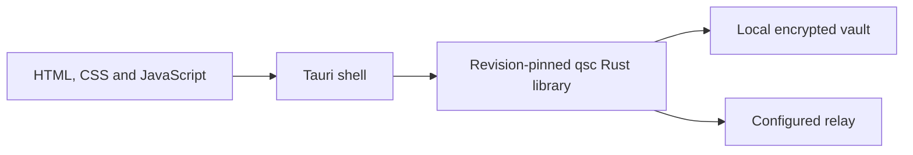

# QSL Desktop

**The desktop prototype for QSL's post-quantum messaging research.**

A Tauri application with a Rust client core linked in-process. The current public prototype explores local vaults, identity, relay configuration, invitations and contacts.

> [!WARNING]
> Pre-release, not independently audited and not production-ready. The current public application does not provide message sending or receiving. Do not use it for safety-critical communications.

## Current capabilities

| Area | Public prototype |
|---|---|
| Local lifecycle | Vault creation, identity display, unlock and security settings |
| Relay setup | Relay address, access token, CA configuration and connection reporting |
| Contact setup | Create, redeem and revoke invitations; record and manage contacts |
| Messaging | Sending and receiving are not available |
| Distribution | No supported release package or update channel is established by this README |

Feature descriptions are separate from security qualification. Interfaces and stored development data can change between revisions; use disposable test data.

## Architecture



The frontend uses vanilla web assets. The Rust dependency graph, system webview and operating system remain part of the supply chain and security boundary. A small frontend is an aid to review, not evidence of supply-chain immunity.

Contact aliases are local data. Network activity currently includes invitation-completion checks while unlocked; it is not limited to explicit button presses. The relay can observe traffic metadata. Future transport or message-flow designs are not implemented features merely because they appear in project plans.

## Build for development

Use the repository's [Rust toolchain pin](rust-toolchain.toml), the Tauri v2 CLI and the system dependencies for your Linux distribution. The [CI workflow](.github/workflows/ci.yml) records the build/test environment used by this repository.

The existing development launch path is:

```bash
git clone https://github.com/QuantumShieldLabs/qsl-desktop
cd qsl-desktop
cargo tauri dev
```

There is no npm installation step. Network experiments require a test relay; see [qsl-server](https://github.com/QuantumShieldLabs/qsl-server). The current public target is Linux. Other platform or packaging work is not a supported-release claim.

## Review and contribute

Start with [CONTRIBUTING.md](CONTRIBUTING.md). Useful reports include the application revision, operating system, exact interaction and observed result. Use synthetic data and remove sensitive information from screenshots and logs.

For protocol specifications and cryptographic evidence, see [qsl-protocol](https://github.com/QuantumShieldLabs/qsl-protocol). Report security-sensitive findings privately through [SECURITY.md](SECURITY.md).

## Related components and license

[Protocol and core](https://github.com/QuantumShieldLabs/qsl-protocol) · [Relay](https://github.com/QuantumShieldLabs/qsl-server) · [Encrypted-object service](https://github.com/QuantumShieldLabs/qsl-attachments)

`AGPL-3.0-only`. See [LICENSE](LICENSE).
